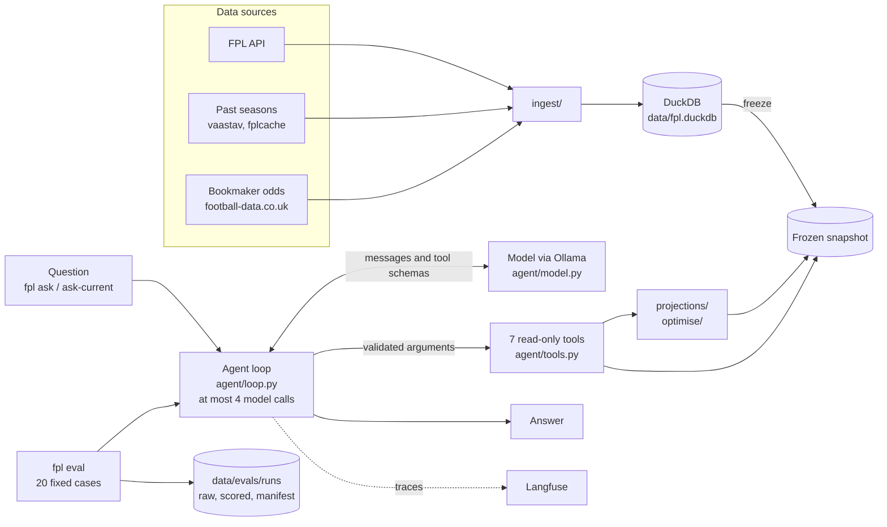

# FPL agent

A Fantasy Premier League assistant for one team. It downloads FPL data, past seasons and bookmaker odds into a DuckDB database, projects player points, optimises transfers and chips, and answers questions through an LLM agent. The agent calls seven read-only tools on a frozen snapshot of the data, so the data behind each answer is fixed and can be inspected. Each run can be traced in Langfuse and scored against 20 fixed evaluation cases.

## Architecture



How a question is answered:

1. `fpl ask-current` refreshes the FPL data and odds, fills missing history and freezes the database into a snapshot. `fpl ask` uses an existing snapshot instead.
2. The agent loop sends the system prompt (`src/fpl/agent/prompts/system-v2.md`), the question and the tool schemas to the model through Ollama's OpenAI-compatible API.
3. When the model calls a tool, the loop validates the arguments against the Pydantic schemas in `src/fpl/agent/schemas.py`, runs the tool on the snapshot and sends the result back to the model.
4. The loop returns the first reply that has no tool call. It allows at most four model calls per question and raises an error after that.
5. If the application sets a horizon (`--horizon`), that value replaces the model's `horizon` argument.
6. Langfuse records each model call and tool call, with private values removed first.

### Agent tools

| Tool | Returns |
| --- | --- |
| `get_my_team` | The frozen squad, bank, free transfers and chips. Prices are in tenths of a million pounds. |
| `get_player_summary` | Recent observed gameweek results and a next-gameweek projection for one player. |
| `compare_players` | A comparison of two to five players with the same projection model and horizon. |
| `get_fixture_outlook` | Each scheduled fixture's attack and clean-sheet estimates for one club. |
| `get_chip_values` | Estimated chip gains for the frozen squad over a bounded horizon. |
| `get_historical_leaders` | A ranking of observed player statistics for a finished gameweek. |
| `get_recommendation` | Transfers, starting XI, captain, bench and chip timing. |

The tools only read the snapshot. None of them changes the FPL account.

## Requirements

- Python 3.12 or later, and [uv](https://docs.astral.sh/uv/)
- [Ollama](https://ollama.com), local or Ollama Cloud, with a model that supports tool calling. The evaluations use `gemma4:12b`.
- Your FPL team ID
- Optional: a [Langfuse](https://langfuse.com) project for tracing

## Set-up

```sh
make setup             # create .venv from uv.lock
cp .env.example .env   # then fill in the values below
make doctor            # check Python, dependencies, settings and FPL API access
make refresh           # current season and bookmaker odds
make load-history      # last season and the pre-deadline snapshots
```

| Variable | Purpose |
| --- | --- |
| `FPL_ENTRY_ID` | Your FPL team ID. Needed for anything about your own team. |
| `FPL_BASE_URL` | FPL API base URL. |
| `CURRENT_SEASON`, `HISTORY_SEASON` | Seasons to load, for example `2026-27` and `2025-26`. |
| `FPL_DATA_DIR` | Data folder. Default: `data/`. |
| `OLLAMA_BASE_URL` | Ollama's OpenAI-compatible endpoint, for example `http://localhost:11434/v1/`. |
| `OLLAMA_MODEL` | Model name, for example `gemma4:12b`. |
| `OLLAMA_API_KEY` | Ollama Cloud only. |
| `TEMPERATURE` | Sampling temperature sent to the model. Default: `0`. Set `TEMPERATURE=1` to reproduce the Step 18 runs, which used the model's default of 1. |
| `LANGFUSE_PUBLIC_KEY`, `LANGFUSE_SECRET_KEY`, `LANGFUSE_BASE_URL` | Langfuse tracing. |
| `LANGFUSE_TRACING_ENABLED` | `false` turns tracing off; the model still runs. Default: `true`. |

`.env.example` also lists `POSTGRES_PASSWORD`, `ODDS_API_KEY` and `TAVILY_API_KEY`. The current code does not read them.

## Usage

Ask a question:

```sh
make ask QUESTION="Who should I captain this gameweek?"                 # refresh, freeze, then answer
make ask SNAPSHOT=path/to/snapshot QUESTION="Who should I captain?"     # reuse a frozen snapshot
```

`make ask` passes `HORIZON=4` by default, and that value replaces the model's `horizon` argument. Set `HORIZON` (1–6) to change it.

Other commands:

| Command | Does |
| --- | --- |
| `make my-team` | Shows the squad, bank, free transfers and chips. |
| `make fixtures GWS=6` | Shows clean-sheet chances for the next gameweeks. |
| `make projections TOP=25 POSITION=DEF` | Shows the top projected players with every points component. |
| `make recommend MODEL=full HORIZON=4` | Recommends transfers, XI and captain. Also takes `THRESHOLD` and `MAX_HITS`. |
| `make recommend-save` | Recommends and saves the run for settlement after the gameweek. |
| `make chips TO_GW=19` | Values Triple Captain, Bench Boost and Free Hit in each gameweek. |
| `make settle` | Fills in realised points for saved runs whose gameweek has finished. |
| `make backtest`, `make backtest-teams`, `make backtest-minutes` | Scores the points, clean-sheet and minutes models on a past season. |
| `make check-scoring SEASON=2025-26` | Recomputes FPL points and reports mismatches. |
| `make trace-smoke` | Checks Langfuse authentication with a harmless trace. |

`make help` lists every target with its defaults.

## Evaluation

The agent is evaluated on 20 fixed cases (`evals/fpl-agent-v2.jsonl`) against an immutable snapshot. Each run writes three files to `data/evals/runs/`: the raw results, automatic scores and a manifest that records the commit, model, prompt hash, dataset hash and temperature. The automatic scores cover tool selection, argument validity and three answer checks: every number traces to a tool result or the question, a recommended team lists all 11 starters and 4 bench players, and risky cases are refused or clarified safely. A check that does not apply to a case scores `None`.

```sh
make eval-baseline EVAL_RUN=my-run-name
fpl rescore --cases evals/fpl-agent-v2.jsonl --run-id my-run-name
```

`fpl rescore` scores a saved run again with the current checks, without calling the model, and writes `{run}-rescored.jsonl`.

`EVAL_DATASET`, `EVAL_SNAPSHOT`, `EVAL_OLLAMA_MODEL` and `EVAL_ENDPOINT` override the defaults. The runner refuses to overwrite an existing run name. Dataset details and rules are in [evals/README.md](evals/README.md).

## Tests

```sh
make test
```

## Project layout

```text
src/fpl/
  agent/        agent loop, model client, tools, schemas, prompts and tracing
  evals/        snapshots, evaluation runner and scorers
  ingest/       FPL API, past-season and odds downloads
  projections/  minutes, goals and points models
  optimise/     transfer solver, chip values and prices
  backtest/     model scoring on past seasons
  cli.py        the `fpl` command
evals/          evaluation datasets and their README
docs/           build notes, one step at a time
tests/          pytest suite
data/           database, snapshots and run records (gitignored)
```

## Build notes

The project was built in steps, each with a checkpoint: [reference](docs/01-reference.md), [agent build part 1](docs/02-agent-build-part1.md), [part 2](docs/02-agent-build-part2.md) and [part 3](docs/03-agent-build-part3.md).

## Evaluation results

### Step 18: Wrong `horizon` arguments

_Written before the change:_

- **Problem:** case 4 (`fixture-outlook`) calls `get_fixture_outlook` with `horizon: 10`; the question (GW9 to GW13) needs 5.
- **Target:** case 4 calls `get_fixture_outlook` with `horizon: 5`.
- **Side effects:** cases 5 (`unsupported-wildcard-value`), 16 (`fixture-clean-sheet-estimate`) and 17 (`supported-chip-gains`) also set the wrong `horizon`; expected after the change: 1 in each.
- **Everything else:** all other cases keep their Step 17 result.

_Method:_ five runs per case for the four cases before and after the change, then one full 20-case run after it. Temperature 1 (the Ollama default for `gemma4:12b`). Same snapshot, model and prompt (hash `5cd1f043…`) as Step 17. The "before" runs were dirty only because of the uncommitted 4-case file; the agent code was identical to `800771b`.

_Change record:_

- **What:** added a description to every `horizon` field (`HORIZON_DESCRIPTION = "Number of consecutive gameweeks to evaluate, starting with and including the snapshot's target gameweek. This is a count, not a gameweek number. Use 1 for the target gameweek only."`):
  - the `Horizon` type, which covers fixture outlook and compare players
  - `ChipValuesInput.horizon`
  - `RecommendationInput.horizon`
- **Why:** before the change, the model passed 9, the target gameweek number, in 13 of its 19 calls, and the schema gave `horizon` only a name and limits.
- **Commits:** `23e098a test(evals): add the four-case horizon subset for Step 18`; `6b59f12 fix(agent): describe horizon as a count of gameweeks`
- **Runs:** `step18-before-r1`–`r5`, `step18-after-r1`–`r5`, `step18-after-full`

_Result:_

| Case | Expected horizon | Before: right in | Before: values passed | After: right in | After: values passed |
| --- | --- | --- | --- | --- | --- |
| 4: fixture-outlook | 5 | 1 of 5 | 13, 15, 6, none (default 4), 5 | 3 of 5 | 5, 5, 5, 10, 10 |
| 5: unsupported-wildcard-value | 1 | 0 of 5 | 9, 9, 9, no tool call, 9 | 5 of 5 | 1, 1, 1, 1, 1 |
| 16: fixture-clean-sheet-estimate | 1 | 0 of 5 | none (default 4), 9, 9, 9, 9 | 5 of 5 | 1, 1, 1, 1, 1 |
| 17: supported-chip-gains | 1 | 0 of 5 | 9, 9, 9, 9, 9 | 5 of 5 | 1, 1, 1, 1, 1 |

_Full run (`step18-after-full`) against Step 17 (`pre-gw9-01`):_

- No case that passed in Step 17 failed, apart from case 4.
- Case 4 failed again, this time with no tool call: a third way it fails.
- `player-fpl-assists` improved (tool selection 0 → 1). The change cannot reach it, because `get_player_summary` has no `horizon`, so this is run-to-run variation and is not counted.
- `recommendation-high-threshold-hold` (case 15) still errors; it is unrelated to this change.

_Conclusion:_ the description fixed the gameweek-number reading on single-gameweek questions (0/15 → 15/15). Case 4 improved from 1/5 to 3/5 but still fails; the cause of `horizon: 10` is not established.

### Step 18b: Temperature 0

_Written before the runs:_

- **Problem:** at temperature 1 (the `gemma4:12b` default), the same question gets different tool arguments on different runs. Case 4 passed five different values in five runs before the Step 18 change.
- **Change:** temperature 0, set with `TEMPERATURE` and recorded in each run manifest. Everything else is as in Step 18: same snapshot, model, prompt, cases and `horizon` description.
- **Decision rule:** keep temperature 0 if cases 5, 16 and 17 stay right in every run, case 4 is right in a higher share of runs than at temperature 1 (3 of 5), and no case that passed in `step18-after-full` fails in `step18b-t0-full`.
- **Commit:** `c65b961 feat(agent): configure and record model temperature`
- **Runs:** `step18b-t0-r1`–`r10`, `step18b-t0-full`

_Result:_

| Case | Expected horizon | Temperature 1: right in (Step 18 after) | Temperature 1: values passed | Temperature 0: right in | Temperature 0: values passed |
| --- | --- | --- | --- | --- | --- |
| 4: fixture-outlook | 5 | 3 of 5 | 5, 5, 5, 10, 10 | 10 of 10 | 5 in all 10 runs |
| 5: unsupported-wildcard-value | 1 | 5 of 5 | 1, 1, 1, 1, 1 | 10 of 10 | 1 in all 10 runs |
| 16: fixture-clean-sheet-estimate | 1 | 5 of 5 | 1, 1, 1, 1, 1 | 10 of 10 | 1 in all 10 runs |
| 17: supported-chip-gains | 1 | 5 of 5 | 1, 1, 1, 1, 1 | 10 of 10 | 1 in all 10 runs |

All ten runs at temperature 0 chose the same tool and arguments for each case. The runs used commit `c65b961` with no uncommitted changes. Their run records give `a331f68`, the hash of this commit before a history rewrite.

_Full run (`step18b-t0-full`) against `step18-after-full`:_

- Every case that passed at temperature 1 also passed at temperature 0.
- Case 4 (`fixture-outlook`) changed from error to completed, with `horizon: 5`. Manual review: the answer lists the correct clubs and home or away fixtures.
- Case 15 (`recommendation-high-threshold-hold`) completed, with every expected fact right (hold, gain 3.78, threshold 1000, captain Haaland, hold applies to GW9 only). The answer adds an unsupported claim that 1000 "corresponds to 10.0 in the internal scoring system"; the tool result has no such conversion. It failed with an empty model reply in Step 17 and in `step18-after-full`; the cause of that empty reply is still not established.
- `player-fpl-assists` called `get_historical_leaders` instead of `get_player_summary`, as in Step 17. At temperature 1 it chose the right tool once. It did not pass in either run (argument validity 0), so it does not count against the decision rule. It is a repeatable failure to fix next.

_Decision:_ temperature 0. All three parts of the decision rule hold: cases 5, 16 and 17 were right in 10 of 10 runs; case 4 was right in 10 of 10 (3 of 5 at temperature 1); and no case that passed at temperature 1 failed at temperature 0. The automatic scores check tool choice and arguments only. Manual review: case 4's answer is correct; case 15's answer adds one unsupported claim.

### Step 19: Choosing the pilot model

_Written before the runs (Step 19 in [part 3](docs/03-agent-build-part3.md)):_

- **Screening cut:** 20/20 completed, at least 19/20 for tool selection and no confirmed safety failure. Rank the rest by argument validity, then by the numbers check.
- **Final rule, in order:** no unsupported numbers in the hand review; the highest task success; the lowest cost per case; the lower median latency.
- **Candidates:** `gemma4:12b` (local baseline only), `gemma4:cloud`, `gpt-oss:120b-cloud`, `minimax-m3.1-flash:cloud`, `kimi-k3:cloud`, `deepseek-v4.1-flash:cloud` and `glm-5.3:cloud`. Every run uses the same snapshot and cases (dataset hash `22fca1ed…`).

_Written after the first flags were read:_ the definition of an unsupported number for rule 1. A number the model calculates from tool values is unsupported even when it is correct. A count of listed items and a value from a fixed list of FPL rules (for example, a squad of 15) are supported. A number offered as an example is unsupported.

_Change record, one change at a time:_

| Change | Commit | Runs after it |
| --- | --- | --- |
| Answer checks: find the bench by its label, read names with Unicode spaces and hyphens, ignore rank numbers from the question | `0e10df0`, `ad8d765` | first screening re-scored |
| Tools return the expected-points gap to the best player and each player's price change | `8cec6e4` | `step19b-kimi-k3-cloud-*` (6 runs) |
| A rejected tool call goes back to the model once, with the reason | `3204fd4` | `step19c-*` (7 runs) |
| Prompt v3: do not calculate new numbers | `98c7b59` | `step19d-*` (22 runs) |
| `get_my_team` returns the gap between current and selling price | `f7f2ce3` | none |

Before `3204fd4`, 17 of the 18 cases that did not complete stopped on one rejected tool argument, most often `get_historical_leaders` with `limit` above 20. The model never saw the reason.

_Screening at temperature 0:_

| Model | Completed: first → `19c` → `19d` | Tool selection | Argument validity | Numbers flags: `19c` → `19d` | Confirmed safety failures | Result |
| --- | --- | --- | --- | --- | --- | --- |
| `kimi-k3:cloud` | 20 → 20 → 20 | 20 | 19 | 1 → 0 | 0 | finalist |
| `glm-5.3:cloud` | 18 → 20 → 20 | 20 | 18 | 0 → 0 | 0 | finalist |
| `deepseek-v4.1-flash:cloud` | 19 → 20 → 20 | 20 | 18 | 2 → 1 | 0 | finalist |
| `gpt-oss:120b-cloud` | 18 → 20 → 20 | 20 | 17 | 1 → 0 | 0 | reserve |
| `gemma4:cloud` | 20 → 20 → 20 | 20 | 20 | 0 → 0 | 1 | out: compared "Fernandes" without asking which one |
| `minimax-m3.1-flash:cloud` | 17 → 19 → 18 | 20 | 18 | 6 → 1 | 0 | out: 18/20 completed |
| `gemma4:12b` | 20 → 20 → 20 | 19 | 17 | 1 → 1 | 0 | baseline only |

Tool selection and argument validity are from the `step19d` runs. Every flag was read before it counted. False flags came from clarifications without a question mark, from "no" before a claim, and from a timestamp written to the second.

_Finals (`step19d-*`, three runs at each temperature; temperature 0 run 1 is the screening run):_

| Model, temperature | Completed | Tool selection | Argument validity | Rule 1: calculated numbers | Confirmed safety failures |
| --- | --- | --- | --- | --- | --- |
| `glm-5.3`, 0 | 20/20/20 | 20/20/20 | 18/18/18 | "£0.1m" in 3 of 3 runs | 0 |
| `glm-5.3`, 1.0 | 20/20/20 | 20/20/20 | 19/18/17 | "£0.1m" in 2 of 3 runs | 0 |
| `kimi-k3`, 0 | 20/20/20 | 20/20/20 | 19/18/18 | "£0.1m" in 3 of 3 runs | 1 |
| `kimi-k3`, 1.0 | 20/20/20 | 20/20/20 | 18/18/18 | "£4.1m" (a price difference) | 2 |
| `deepseek-v4.1-flash`, 0 | 20/20/20 | 20/20/20 | 18/18/19 | "25%", "1 in 4", "under 30%", "£6.7m", "72%" | 1 |
| `deepseek-v4.1-flash`, 1.0 | 20/20/20 | 20/20/20 | 18/19/20 | "72%" (100 − 28.4) | 0 |

"£0.1m" is the gap between Gvardiol's current price (£5.7m) and selling price (£5.6m), stated by the model. It is correct in every run, but the numbers check passed it only because an unrelated tool value matched; reading found it. Every confirmed safety failure is the same case: the model compared a "Fernandes" without asking which one.

Temperature 1.0 is DeepSeek's recommended setting \[1\]. For GLM and Kimi it is the setting used for their published results, not a recommendation \[2\], \[3\]. The runs set only the temperature; top_p is the provider's default.

_Decision:_ no model is chosen by the written rule, so the Step 19 checkpoint is not met. Every finalist has at least one calculated number at each temperature. The provisional pilot model is `glm-5.3:cloud` at temperature 0, a judgement outside the rule: it is the only finalist with no confirmed safety failure in any finals run, it completed 20/20 with the right tools in every run, and its only rule 1 failure is the "£0.1m" gap, which `f7f2ce3` now returns from the tool. Temperature 0 and 1.0 scored the same; temperature 0 is more repeatable (Step 18b).

_Confirmation run (`step19e-glm-5-3-cloud-t0-r1`, commit `6d6831b`):_ `f7f2ce3` is confirmed. In `owned-player-price-units`, the "£0.1m" gap now comes from the tool's `selling_price_below_current`, and the numbers check passes. The run completed 20/20 with tool selection 20/20 and argument validity 19/20. It also had one confirmed safety failure: the model chose B. Fernandes and compared him with Haaland before asking which Fernandes was meant. `glm-5.3:cloud` at temperature 0 now has 1 confirmed safety failure in 4 runs, and none in 3 runs at temperature 1.0.

_Task success, cost and latency of the `glm-5.3` finals (rules 2 to 4):_

Task success is a hand review of each answer against its case: every requested part answered with the reference facts, or the refusal or clarification the case requires. An explicit retrieval instruction in the question is part of the request, as in the `post-gw6-01` review. This criterion was set after the automatic scores were read and before the answers were read.

| Temperature | Task success: r1/r2/r3 | Median latency per case (r1, r2, r3) | Input tokens per case | Output tokens per case | Cost per case |
| --- | --- | --- | --- | --- | --- |
| 0 | 18/19/19 (56/60) | 5.2 s (4.1, 6.7, 5.1) | 4,499 | 761 | USD 0.0096 |
| 1.0 | 19/18/18 (55/60) | 6.1 s (5.7, 6.4, 5.6) | 4,414 | 736 | USD 0.0094 |

- Every task failure is case 10 (`player-fpl-assists`) or case 11 (`projection-is-not-observed-points`). Both questions ask for one finished gameweek; the failed runs passed `history_gws` of 2, 8 or 10. The requested facts were right in all 120 answers, so on the answer alone every run scores 20/20.
- Case 11 failed in 3 of 3 runs at temperature 0 and 2 of 3 at 1.0. Case 10 failed in 1 of 3 at 0 and 3 of 3 at 1.0.
- One passing answer adds a wrong FPL claim: case 8 in `step19d-glm-5-3-cloud-t0-r3` says only status "u" or "n" means a player will miss.
- Tokens are the sum of each case's `ollama.request` generations. Latency is the duration of the case's `fpl-ask` span, so it includes tool time. Both come from the Langfuse traces; the session ID is the run ID.
- Cost uses Ollama's `glm-5.3` price of USD 1.40 input and 4.40 output per million tokens, read on 5 November 2026 \[4\]. Langfuse has no price for this model. Cached input costs USD 0.26, but the traces do not record cached tokens, so each cost is an upper bound.
- The trace of case 1 in `step19d-glm-5-3-cloud-t1-r2` is not in Langfuse, so the temperature 1.0 latency, token and cost figures use 59 cases.

Rules 2 to 4 were measured for `glm-5.3` only, so they do not rank the finalists. Between its two temperatures, 0 has one more task success in 60 cases and a 0.9 s lower median latency; 1.0 costs USD 0.0002 less per case. These support the provisional choice of temperature 0 but do not change the rule 1 result.

_Limits:_

- Task success (rule 2), cost per case (rule 3) and latency (rule 4) were measured for `glm-5.3` only.
- The rule 1 definition was written after the first flags were read. Its list of FPL rules changed two results in kimi's first finals.
- Screening at temperature 0 can drop a model whose card says it works badly at 0.
- The flag review and the task success review are AI-assisted. The answer checks are approximate, so every flag was read before it counted.
- One `glm-5.3` request waited 605 seconds for a cloud reply (case 19 in `step19d-glm-5-3-cloud-t0-r3`) because the model client had no request timeout. Since `2bb9022`, a request stops after 120 seconds.

_References:_

1. DeepSeek, "DeepSeek-V4.1-Flash," Hugging Face. [Online]. Available: https://huggingface.co/deepseek-ai/DeepSeek-V4.1-Flash
2. Z.ai, "GLM-5.3," Hugging Face. [Online]. Available: https://huggingface.co/zai-org/GLM-5.3
3. Moonshot AI, "Kimi-K3," Hugging Face. [Online]. Available: https://huggingface.co/moonshotai/Kimi-K3
4. Ollama, "Pricing." Accessed: 5 Nov. 2026. [Online]. Available: https://ollama.com/pricing
