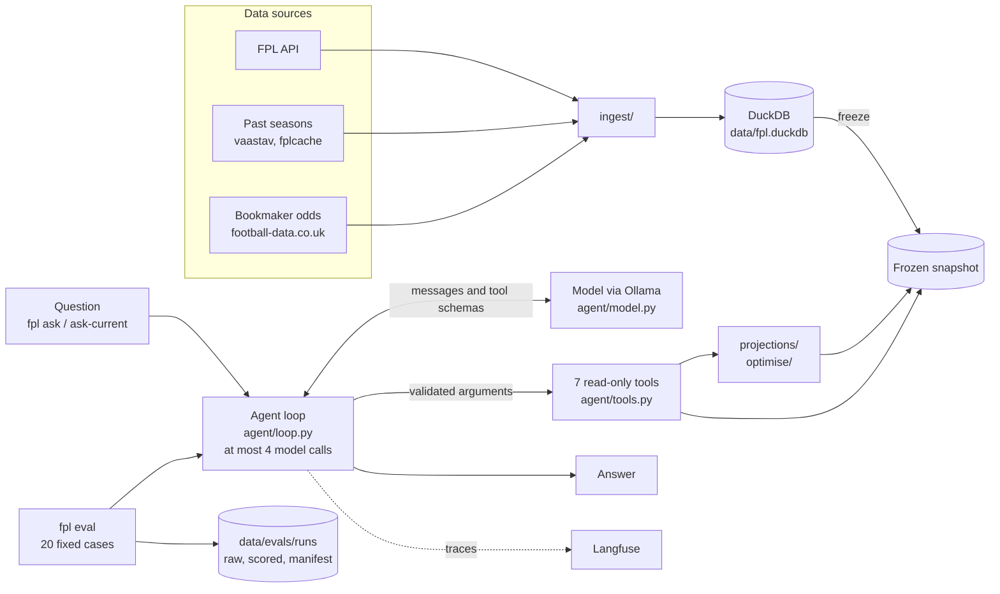

# FPL agent

A Fantasy Premier League assistant for one team. It downloads FPL data, past seasons and bookmaker odds into a DuckDB database, projects player points, optimises transfers and chips, and answers questions through an LLM agent. The agent calls seven read-only tools on a frozen snapshot of the data, so the data behind each answer is fixed and can be inspected. Each run can be traced in Langfuse and scored against 20 fixed evaluation cases.

## Architecture



How a question is answered:

1. `fpl ask-current` refreshes the FPL data and odds, fills missing history and freezes the database into a snapshot. `fpl ask` uses an existing snapshot instead.
2. The agent loop sends the system prompt (`src/fpl/agent/prompts/system-v2.md`), the question and the tool schemas to the model through Ollama's OpenAI-compatible API.
3. When the model calls a tool, the loop validates the arguments against the Pydantic schemas in `src/fpl/agent/schemas.py`, runs the tool on the snapshot and sends the result back to the model.
4. The loop returns the first reply that has no tool call. It allows at most four model calls per question and raises an error after that.
5. If the application sets a horizon (`--horizon`), that value replaces the model's `horizon` argument.
6. Langfuse records each model call and tool call, with private values removed first.

### Agent tools

| Tool | Returns |
| --- | --- |
| `get_my_team` | The frozen squad, bank, free transfers and chips. Prices are in tenths of a million pounds. |
| `get_player_summary` | Recent observed gameweek results and a next-gameweek projection for one player. |
| `compare_players` | A comparison of two to five players with the same projection model and horizon. |
| `get_fixture_outlook` | Each scheduled fixture's attack and clean-sheet estimates for one club. |
| `get_chip_values` | Estimated chip gains for the frozen squad over a bounded horizon. |
| `get_historical_leaders` | A ranking of observed player statistics for a finished gameweek. |
| `get_recommendation` | Transfers, starting XI, captain, bench and chip timing. |

The tools only read the snapshot. None of them changes the FPL account.

## Requirements

- Python 3.12 or later, and [uv](https://docs.astral.sh/uv/)
- [Ollama](https://ollama.com), local or Ollama Cloud, with a model that supports tool calling. The evaluations use `gemma4:12b`.
- Your FPL team ID
- Optional: a [Langfuse](https://langfuse.com) project for tracing

## Set-up

```sh
make setup             # create .venv from uv.lock
cp .env.example .env   # then fill in the values below
make doctor            # check Python, dependencies, settings and FPL API access
make refresh           # current season and bookmaker odds
make load-history      # last season and the pre-deadline snapshots
```

| Variable | Purpose |
| --- | --- |
| `FPL_ENTRY_ID` | Your FPL team ID. Needed for anything about your own team. |
| `FPL_BASE_URL` | FPL API base URL. |
| `CURRENT_SEASON`, `HISTORY_SEASON` | Seasons to load, for example `2026-27` and `2025-26`. |
| `FPL_DATA_DIR` | Data folder. Default: `data/`. |
| `OLLAMA_BASE_URL` | Ollama's OpenAI-compatible endpoint, for example `http://localhost:11434/v1/`. |
| `OLLAMA_MODEL` | Model name, for example `gemma4:12b`. |
| `OLLAMA_API_KEY` | Ollama Cloud only. |
| `TEMPERATURE` | Sampling temperature sent to the model. Default: `0`. Set `TEMPERATURE=1` to reproduce the Step 18 runs, which used the model's default of 1. |
| `LANGFUSE_PUBLIC_KEY`, `LANGFUSE_SECRET_KEY`, `LANGFUSE_BASE_URL` | Langfuse tracing. |
| `LANGFUSE_TRACING_ENABLED` | `false` turns tracing off; the model still runs. Default: `true`. |

`.env.example` also lists `POSTGRES_PASSWORD`, `ODDS_API_KEY` and `TAVILY_API_KEY`. The current code does not read them.

## Usage

Ask a question:

```sh
make ask QUESTION="Who should I captain this gameweek?"                 # refresh, freeze, then answer
make ask SNAPSHOT=path/to/snapshot QUESTION="Who should I captain?"     # reuse a frozen snapshot
```

`make ask` passes `HORIZON=4` by default, and that value replaces the model's `horizon` argument. Set `HORIZON` (1–6) to change it.

Other commands:

| Command | Does |
| --- | --- |
| `make my-team` | Shows the squad, bank, free transfers and chips. |
| `make fixtures GWS=6` | Shows clean-sheet chances for the next gameweeks. |
| `make projections TOP=25 POSITION=DEF` | Shows the top projected players with every points component. |
| `make recommend MODEL=full HORIZON=4` | Recommends transfers, XI and captain. Also takes `THRESHOLD` and `MAX_HITS`. |
| `make recommend-save` | Recommends and saves the run for settlement after the gameweek. |
| `make chips TO_GW=19` | Values Triple Captain, Bench Boost and Free Hit in each gameweek. |
| `make settle` | Fills in realised points for saved runs whose gameweek has finished. |
| `make backtest`, `make backtest-teams`, `make backtest-minutes` | Scores the points, clean-sheet and minutes models on a past season. |
| `make check-scoring SEASON=2025-26` | Recomputes FPL points and reports mismatches. |
| `make trace-smoke` | Checks Langfuse authentication with a harmless trace. |

`make help` lists every target with its defaults.

## Evaluation

The agent is evaluated on 20 fixed cases (`evals/fpl-agent-v2.jsonl`) against an immutable snapshot. Each run writes three files to `data/evals/runs/`: the raw results, automatic scores (tool selection and argument validity) and a manifest that records the commit, model, prompt hash, dataset hash and temperature.

```sh
make eval-baseline EVAL_RUN=my-run-name
```

`EVAL_DATASET`, `EVAL_SNAPSHOT`, `EVAL_OLLAMA_MODEL` and `EVAL_ENDPOINT` override the defaults. The runner refuses to overwrite an existing run name. Dataset details and rules are in [evals/README.md](evals/README.md).

## Tests

```sh
make test
```

## Project layout

```text
src/fpl/
  agent/        agent loop, model client, tools, schemas, prompts and tracing
  evals/        snapshots, evaluation runner and scorers
  ingest/       FPL API, past-season and odds downloads
  projections/  minutes, goals and points models
  optimise/     transfer solver, chip values and prices
  backtest/     model scoring on past seasons
  cli.py        the `fpl` command
evals/          evaluation datasets and their README
docs/           build notes, one step at a time
tests/          pytest suite
data/           database, snapshots and run records (gitignored)
```

## Build notes

The project was built in steps, each with a checkpoint: [reference](docs/01-reference.md), [agent build part 1](docs/02-agent-build-part1.md), [part 2](docs/02-agent-build-part2.md) and [part 3](docs/03-agent-build-part3.md).

## Evaluation results

### Step 18: Wrong `horizon` arguments

_Written before the change:_

- **Problem:** case 4 (`fixture-outlook`) calls `get_fixture_outlook` with `horizon: 10`; the question (GW9 to GW13) needs 5.
- **Target:** case 4 calls `get_fixture_outlook` with `horizon: 5`.
- **Side effects:** cases 5 (`unsupported-wildcard-value`), 16 (`fixture-clean-sheet-estimate`) and 17 (`supported-chip-gains`) also set the wrong `horizon`; expected after the change: 1 in each.
- **Everything else:** all other cases keep their Step 17 result.

_Method:_ five runs per case for the four cases before and after the change, then one full 20-case run after it. Temperature 1 (the Ollama default for `gemma4:12b`). Same snapshot, model and prompt (hash `5cd1f043…`) as Step 17. The "before" runs were dirty only because of the uncommitted 4-case file; the agent code was identical to `89e4d96`.

_Change record:_

- **What:** added a description to every `horizon` field (`HORIZON_DESCRIPTION = "Number of consecutive gameweeks to evaluate, starting with and including the snapshot's target gameweek. This is a count, not a gameweek number. Use 1 for the target gameweek only."`):
  - the `Horizon` type, which covers fixture outlook and compare players
  - `ChipValuesInput.horizon`
  - `RecommendationInput.horizon`
- **Why:** before the change, the model passed 9, the target gameweek number, in 13 of its 19 calls, and the schema gave `horizon` only a name and limits.
- **Commits:** `10917fb test(evals): add the four-case horizon subset for Step 18`; `7f27aba fix(agent): describe horizon as a count of gameweeks`
- **Runs:** `step18-before-r1`–`r5`, `step18-after-r1`–`r5`, `step18-after-full`

_Result:_

| Case | Expected horizon | Before: right in | Before: values passed | After: right in | After: values passed |
| --- | --- | --- | --- | --- | --- |
| 4: fixture-outlook | 5 | 1 of 5 | 13, 15, 6, none (default 4), 5 | 3 of 5 | 5, 5, 5, 10, 10 |
| 5: unsupported-wildcard-value | 1 | 0 of 5 | 9, 9, 9, no tool call, 9 | 5 of 5 | 1, 1, 1, 1, 1 |
| 16: fixture-clean-sheet-estimate | 1 | 0 of 5 | none (default 4), 9, 9, 9, 9 | 5 of 5 | 1, 1, 1, 1, 1 |
| 17: supported-chip-gains | 1 | 0 of 5 | 9, 9, 9, 9, 9 | 5 of 5 | 1, 1, 1, 1, 1 |

_Full run (`step18-after-full`) against Step 17 (`pre-gw9-01`):_

- No case that passed in Step 17 failed, apart from case 4.
- Case 4 failed again, this time with no tool call: a third way it fails.
- `player-fpl-assists` improved (tool selection 0 → 1). The change cannot reach it, because `get_player_summary` has no `horizon`, so this is run-to-run variation and is not counted.
- `recommendation-high-threshold-hold` (case 15) still errors; it is unrelated to this change.

_Conclusion:_ the description fixed the gameweek-number reading on single-gameweek questions (0/15 → 15/15). Case 4 improved from 1/5 to 3/5 but still fails; the cause of `horizon: 10` is not established.

### Step 18b: Temperature 0

_Written before the runs:_

- **Problem:** at temperature 1 (the `gemma4:12b` default), the same question gets different tool arguments on different runs. Case 4 passed five different values in five runs before the Step 18 change.
- **Change:** temperature 0, set with `TEMPERATURE` and recorded in each run manifest. Everything else is as in Step 18: same snapshot, model, prompt, cases and `horizon` description.
- **Decision rule:** keep temperature 0 if cases 5, 16 and 17 stay right in every run, case 4 is right in a higher share of runs than at temperature 1 (3 of 5), and no case that passed in `step18-after-full` fails in `step18b-t0-full`.
- **Commit:** `…`
- **Runs:** `step18b-t0-r1`–`r3`, `step18b-t0-full`

_Result:_

| Case | Expected horizon | Temperature 1: right in (Step 18 after) | Temperature 1: values passed | Temperature 0: right in | Temperature 0: values passed |
| --- | --- | --- | --- | --- | --- |
| 4: fixture-outlook | 5 | 3 of 5 | 5, 5, 5, 10, 10 | … of 3 | … |
| 5: unsupported-wildcard-value | 1 | 5 of 5 | 1, 1, 1, 1, 1 | … of 3 | … |
| 16: fixture-clean-sheet-estimate | 1 | 5 of 5 | 1, 1, 1, 1, 1 | … of 3 | … |
| 17: supported-chip-gains | 1 | 5 of 5 | 1, 1, 1, 1, 1 | … of 3 | … |

_Full run (`step18b-t0-full`) against `step18-after-full`:_

- …

_Decision:_ temperature … , because … .
